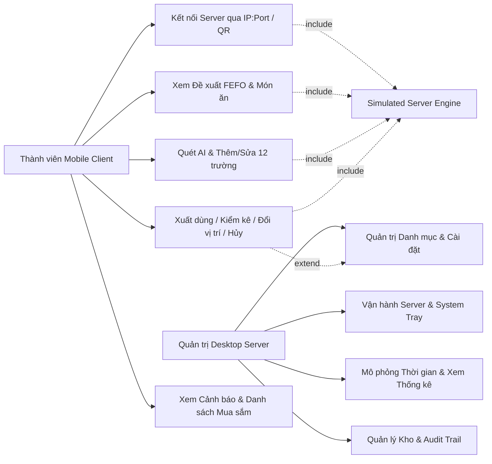
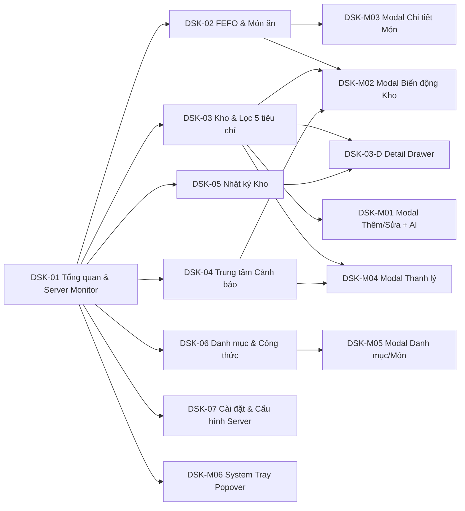
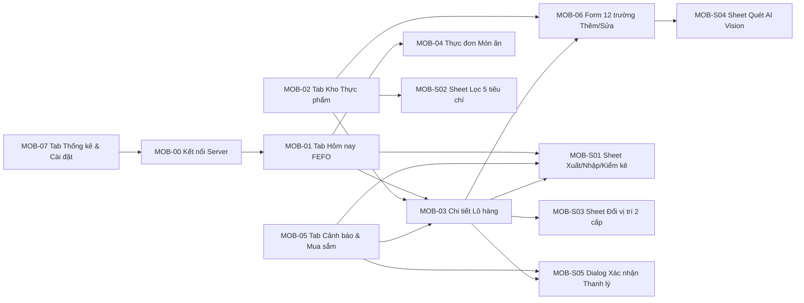
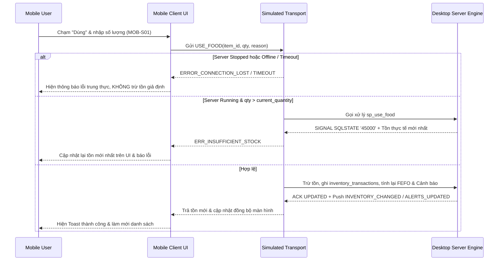

# Specification: Interactive Client–Server UI Prototype — Quản lý Thực phẩm Gia đình & Đề xuất FEFO

**Feature Directory**: `specs/001-ui-prototype`  
**Status**: Approved Design Implementation (`UI Prototype`)  
**Canonical Domain References**:
- `Quan_ly_Thuc_Pham/docs/Phân rã chức năng.txt`
- `food_management.sql`
- `Quan_ly_Thuc_Pham/docs/Thiet_ke_cau_truc_giao_dien_du_kien.md`

---

## 1. User Context, Actors & Use Cases

### 1.1. Actors & Personas
- **Quản trị viên Gia đình (Desktop Server Operator)**: Vận hành ứng dụng Desktop trên máy tính gia đình; khởi động/tạm dừng Server Listener nền (`System Tray`), quản lý toàn bộ kho thực phẩm, cấu hình ngưỡng cảnh báo, quản trị danh mục nền (`categories`, `units`, `storage_locations`, `recipes`), tra cứu Audit Trail, và sử dụng thanh mô phỏng ngày (`-1d/+1d/+3d/+7d`) để kiểm thử FEFO.
- **Thành viên Gia đình (Mobile Client User)**: Sử dụng ứng dụng trên điện thoại trong bếp hoặc khi đi chợ; kết nối tới Desktop Server qua LAN (`IP:Port` hoặc QR), xem thực phẩm ưu tiên dùng trước hôm nay (`FEFO`), xem món ăn gợi ý, xuất dùng nhanh nguyên liệu, kiểm kê, thêm món bằng form 12 trường hoặc Quét AI Vision, và xem danh sách cần mua bổ sung.
- **Simulated Network & Background Server (`Client–Server Transport`)**: Thành phần giả lập giao tiếp Client–Server, thực thi kiểm tra tồn kho (`sp_use_food` / trigger logic), phát sự kiện đồng bộ và cho phép bật/tắt lỗi kết nối, độ trễ, hoặc xung đột tồn kho phục vụ trình diễn Prototype.

### 1.2. Core User Stories (Prioritized)
- **US1 (P1 — Đề xuất FEFO & Gợi ý Món ăn — `DSK-02`, `MOB-01`, `MOB-04`, `DSK-M03`)**: Người dùng trên cả Desktop và Mobile xem danh sách thực phẩm đủ điều kiện (`status = 'Đang sử dụng'`, `current_quantity > 0`, chưa hết hạn `DaysRemaining >= 0`) được sắp xếp theo FEFO (`expiry_date ASC`), đồng hạn theo FIFO (`import_date ASC`), gắn mức ưu tiên (`Cao`, `Trung bình`, `Thấp`), và gợi ý công thức nấu ăn phù hợp với nguyên liệu sẵn có; người dùng có thể xuất dùng nhanh ngay từ đề xuất.
- **US2 (P1 — Quản lý Thực phẩm, Form 12 Trường, Quét AI & Xuất/Nhập/Kiểm kê — `DSK-03`, `DSK-03-D`, `DSK-M01`, `DSK-M02`, `DSK-M04`, `MOB-02`, `MOB-03`, `MOB-06`, `MOB-S01`, `MOB-S03`, `MOB-S04`, `MOB-S05`)**: Người dùng thêm/sửa lô thực phẩm với 12 trường (`IN01`–`IN12`), kiểm tra trùng mã/tên lô để ghép hoặc tạo mới, quét nhãn/hóa đơn AI giả lập, xuất dùng (`Sử dụng` kiểu `sp_use_food` chống âm kho), nhập thêm, kiểm kê điều chỉnh, đổi vị trí 2 cấp (`Trong/Ngoài tủ lạnh` -> khu vực chi tiết), và thanh lý/xóa mềm (`Đã hủy`) bảo toàn lịch sử.
- **US3 (P1 — Giám sát Server, Kết nối Mobile & Mô phỏng Lỗi Mạng — `DSK-01`, `DSK-07`, `DSK-M06`, `MOB-00`, `MOB-07`)**: Quản trị viên giám sát Dashboard + KPI + Server Console trên Desktop và có thể thu gọn ra System Tray (`DSK-M06`) trong khi Mobile kết nối tới `IP:Port`/QR tại `MOB-00`, xem trạng thái kết nối thực tế và chuyển sang chế độ **Offline Chỉ Xem + Giữ nguyên Form khi Lưu thất bại + Báo lỗi trung thực** khi Server dừng hoặc rớt mạng.
- **US4 (P2 — Trung tâm Cảnh báo Kép, Danh sách Mua sắm & Audit Trail — `DSK-04`, `DSK-05`, `MOB-05`, `MOB-07`)**: Người dùng theo dõi tách biệt 2 nhóm cảnh báo: (1) Đồ đã hết hạn / sắp hết hạn (`<= warning_days_threshold`) để xử lý dùng ngay hoặc thanh lý, và (2) Đồ dưới mức tồn tối thiểu / đã hết kèm **Danh sách Cần mua bổ sung**; đồng thời tra cứu Nhật ký biến động kho (`inventory_transactions`) toàn hệ thống và theo từng lô.
- **US5 (P2 — Quản trị Danh mục Nền tảng, Công thức, Cài đặt Hệ thống & Mô phỏng Thời gian — `DSK-06`, `DSK-07`, `DSK-M05`, `MOB-07`)**: Quản trị viên Desktop thêm/sửa/xóa có kiểm soát (`categories`, `units`, `storage_locations` 2 cấp, `recipes`), cấu hình múi giờ/ngưỡng cảnh báo/mức tồn tối thiểu mặc định/quy tắc FEFO/mạng Server, và trượt ngày mô phỏng (`-1d/+1d/+3d/+7d`) để chứng minh hệ thống tự tính lại toàn bộ FEFO, Cảnh báo và Badge tức thì.

### 1.3. Use Case Overview Diagram


---

## 2. Functional Decomposition Tree (Cây Phân Rã Chức Năng)

> Tất cả nút lá cấp 3 (`N.x.y`) tuân thủ **Atomicity Test** (1 động từ + 1 đối tượng, không gộp hành động bằng `"/"`, `"&"`, `"và"`).

### Subsystem 1: Đề xuất Sử dụng Thực phẩm Theo FEFO & Gợi ý Món ăn (25 atomic functions)
├── 1.1 Xác định thực phẩm đủ điều kiện tồn kho
│   ├── 1.1.1 Truy vấn danh sách lô trong và ngoài tủ lạnh
│   ├── 1.1.2 Kiểm tra số lượng tồn dương cho từng lô
│   ├── 1.1.3 Loại bỏ lô có số lượng bằng không
│   ├── 1.1.4 Kiểm tra trạng thái lô đang sử dụng
│   └── 1.1.5 Tổng hợp tập lô đủ điều kiện vào FEFO
├── 1.2 Tính hạn sử dụng và phân loại trạng thái hạn
│   ├── 1.2.1 Đọc ngày hệ thống theo múi giờ cấu hình
│   ├── 1.2.2 Tính số ngày còn lại đến hạn sử dụng
│   ├── 1.2.3 Phát hiện thực phẩm đã quá hạn sử dụng
│   ├── 1.2.4 Tách thực phẩm quá hạn sang danh sách xử lý
│   └── 1.2.5 Phân loại thực phẩm sắp hết hạn theo ngưỡng
├── 1.3 Sắp xếp thứ tự ưu tiên FEFO & FIFO
│   ├── 1.3.1 So sánh ngày hết hạn giữa các lô hợp lệ
│   ├── 1.3.2 Đưa lô có hạn gần nhất lên đầu danh sách
│   ├── 1.3.3 Phát hiện các lô trùng ngày hết hạn
│   ├── 1.3.4 So sánh ngày nhập để sắp FIFO cho lô cùng hạn
│   └── 1.3.5 Gán mức ưu tiên Cao, Trung bình, Thấp theo ngưỡng
├── 1.4 Tạo đề xuất sử dụng và gợi ý món ăn
│   ├── 1.4.1 Sinh nội dung lý do ưu tiên cho từng thẻ đề xuất
│   ├── 1.4.2 Hiển thị danh sách đề xuất theo thứ tự ưu tiên
│   ├── 1.4.3 Đối chiếu lô sắp hết hạn với nguyên liệu công thức
│   ├── 1.4.4 Mở chi tiết công thức hướng dẫn nấu ăn
│   └── 1.4.5 Xuất dùng nhanh nguyên liệu trực tiếp từ đề xuất
└── 1.5 Tự động cập nhật đề xuất khi dữ liệu biến động
    ├── 1.5.1 Tính lại FEFO ngay sau khi thêm lô mới
    ├── 1.5.2 Tính lại FEFO ngay sau khi xuất dùng nguyên liệu
    ├── 1.5.3 Tính lại FEFO ngay khi chỉnh sửa hạn sử dụng
    ├── 1.5.4 Loại lô khỏi FEFO khi tồn kho chạm không
    └── 1.5.5 Tính lại FEFO khi thay đổi ngày hệ thống mô phỏng

### Subsystem 2: Quản lý Thực phẩm, Tồn kho & Tìm kiếm Đa chiều (36 atomic functions)
├── 2.1 Thêm và Sửa hồ sơ thực phẩm (12 trường `IN01`–`IN12`)
│   ├── 2.1.1 Mở biểu mẫu nhập liệu thực phẩm 12 trường
│   ├── 2.1.2 Kiểm tra hợp lệ ngày nhập, hạn dùng, số lượng
│   ├── 2.1.3 Kiểm tra trùng mã thực phẩm trước khi lưu
│   ├── 2.1.4 Phát hiện trùng tên món để chọn ghép lô
│   ├── 2.1.5 Lưu hồ sơ thực phẩm và lô hàng mới vào kho
│   ├── 2.1.6 Chỉnh sửa thông tin chi tiết lô thực phẩm hiện có
│   └── 2.1.7 Lưu lịch sử điều chỉnh khi thay đổi số lượng trực tiếp
├── 2.2 Quét hình ảnh nhãn & hóa đơn bằng AI Vision giả lập
│   ├── 2.2.1 Tải lên ảnh thực phẩm hoặc chọn mẫu quét trên UI
│   ├── 2.2.2 Gửi yêu cầu nhận diện ảnh tới dịch vụ AI giả lập
│   ├── 2.2.3 Điền sẵn tên, loại, thương hiệu, HSD gợi ý vào biểu mẫu
│   └── 2.2.4 Xử lý trạng thái ảnh mờ để chuyển sang nhập tay
├── 2.3 Xóa mềm / Thanh lý và Biến động tồn kho
│   ├── 2.3.1 Xuất dùng số lượng thực phẩm theo kiểm tra chống âm kho
│   ├── 2.3.2 Nhập thêm số lượng bổ sung vào lô thực phẩm
│   ├── 2.3.3 Kiểm kê điều chỉnh số lượng tồn kho thực tế
│   ├── 2.3.4 Đổi vị trí bảo quản hai cấp cho lô hàng
│   ├── 2.3.5 Chuyển lô hết tồn sang trạng thái Đã hết
│   ├── 2.3.6 Hiển thị cảnh báo xác nhận thanh lý thực phẩm còn tồn
│   ├── 2.3.7 Chuyển trạng thái lô sang Đã hủy bảo toàn lịch sử
│   └── 2.3.8 Ghi nhận giao dịch vào Nhật ký biến động Audit Trail
├── 2.4 Tìm kiếm, Lọc đa chiều & Xem chi tiết
│   ├── 2.4.1 Xem danh sách tồn kho dạng bảng Desktop hoặc thẻ Mobile
│   ├── 2.4.2 Mở hồ sơ chi tiết 12 trường và lịch sử riêng của lô
│   ├── 2.4.3 Tìm kiếm nhanh theo từ khóa tên, mã, loại, thương hiệu
│   ├── 2.4.4 Lọc tồn kho theo danh mục loại thực phẩm
│   ├── 2.4.5 Lọc tồn kho theo khu vực trong hoặc ngoài tủ lạnh
│   ├── 2.4.6 Lọc tồn kho theo trạng thái lô hàng
│   ├── 2.4.7 Lọc tồn kho theo phân đoạn hạn sử dụng
│   └── 2.4.8 Đặt lại toàn bộ điều kiện lọc đang áp dụng
└── 2.5 Quản trị Danh mục nền tảng trên Desktop & Tra cứu trên Mobile
    ├── 2.5.1 Xem danh sách loại thực phẩm trong hệ thống
    ├── 2.5.2 Thêm, sửa, xóa có kiểm tra ràng buộc loại thực phẩm
    ├── 2.5.3 Xem danh sách đơn vị tính trong hệ thống
    ├── 2.5.4 Thêm, sửa, xóa có kiểm tra ràng buộc đơn vị tính
    ├── 2.5.5 Xem danh sách vị trí bảo quản phân cấp hai tầng
    ├── 2.5.6 Thêm, sửa, xóa có kiểm tra ràng buộc vị trí bảo quản
    ├── 2.5.7 Xem danh sách công thức món ăn gợi ý
    ├── 2.5.8 Thêm, sửa, xóa công thức món ăn trên Desktop
    └── 2.5.9 Đồng bộ danh mục nền sang giao diện chọn của Mobile

### Subsystem 3: Trung tâm Cảnh báo, Thống kê & Cài đặt Hệ thống (14 atomic functions)
├── 3.1 Giám sát Cảnh báo Hạn dùng & Tồn kho
│   ├── 3.1.1 Tổng hợp danh sách thực phẩm quá hạn và sắp hết hạn
│   ├── 3.1.2 Kích hoạt xử lý Dùng ngay hoặc Thanh lý tại cảnh báo
│   ├── 3.1.3 Tổng hợp danh sách thực phẩm dưới mức tồn tối thiểu
│   ├── 3.1.4 Tạo danh sách cần mua bổ sung theo món dưới ngưỡng
│   └── 3.1.5 Cập nhật số đếm huy hiệu cảnh báo theo thời gian thực
├── 3.2 Thống kê Dashboard & Tra cứu Nhật ký Audit Trail
│   ├── 3.2.1 Hiển thị bốn chỉ số KPI sức khỏe kho thực phẩm
│   ├── 3.2.2 Vẽ biểu đồ xu hướng nhập xuất tiêu thụ theo khoảng ngày
│   ├── 3.2.3 Vẽ biểu đồ phân bố tồn kho theo khu vực trong và ngoài tủ
│   ├── 3.2.4 Hiển thị thống kê rút gọn và log gần đây trên Mobile
│   └── 3.2.5 Lọc nhật ký biến động theo loại thao tác và ngày giao dịch
└── 3.3 Cài đặt tham số nghiệp vụ & Mô phỏng thời gian
    ├── 3.3.1 Cấu hình múi giờ chuẩn và ngày hệ thống hiện hành
    ├── 3.3.2 Cấu hình ngưỡng ngày cảnh báo và mức tồn tối thiểu mặc định
    ├── 3.3.3 Cấu hình ngưỡng phân chia ba mức độ ưu tiên FEFO
    └── 3.3.4 Trượt nhanh ngày mô phỏng bằng cụm nút -1d, +1d, +3d, +7d

### Subsystem 4: Vận hành & Mô phỏng Giao tiếp Client–Server (12 atomic functions)
├── 4.1 Điều khiển Desktop Server & Khay hệ thống
│   ├── 4.1.1 Khởi động hoặc tạm dừng dịch vụ Server Listener giả lập
│   ├── 4.1.2 Hiển thị địa chỉ IP LAN, cổng và mã QR ghép nối
│   ├── 4.1.3 Hiển thị danh sách thiết bị Mobile Client đang kết nối
│   ├── 4.1.4 Ngắt kết nối chủ động tới một phiên Client trên bảng monitor
│   ├── 4.1.5 Thu gọn cửa sổ Desktop xuống Khay hệ thống System Tray
│   └── 4.1.6 Xem nhật ký gói tin Request, Response trong Server Console
├── 4.2 Kết nối Mobile Client & Mô phỏng Xử lý Lỗi mạng
│   ├── 4.2.1 Kết nối Mobile Client tới Desktop Server qua IP, Port hoặc QR
│   ├── 4.2.2 Thực thi kiểm tra Ping, Handshake và đồng bộ danh mục ban đầu
│   ├── 4.2.3 Nhận sự kiện đẩy cập nhật tồn kho, cảnh báo, cấu hình từ Server
│   ├── 4.2.4 Chuyển sang chế độ Offline chỉ xem khi mất kết nối Server
│   ├── 4.2.5 Giữ nguyên dữ liệu biểu mẫu đang nhập khi gặp lỗi mạng lúc lưu
│   └── 4.2.6 Hiển thị thông báo lỗi trung thực khi vượt tồn hoặc timeout mạng

─────────────────────────────────────────────────────
TỔNG KẾT PHÂN RÃ CHỨC NĂNG:
  Subsystem 1 (FEFO & Recipes)               — 25 functions
  Subsystem 2 (Inventory, Search & Catalogs) — 36 functions
  Subsystem 3 (Alerts, Dashboard & Settings) — 14 functions
  Subsystem 4 (Client–Server Simulation)     — 12 functions
  ─────────────────────────────────────────────────────
  TỔNG CỘNG:                                   87 atomic functions
```

---

## 3. Expected Screens & Navigation Flow (27 Màn hình Đã Duyệt)

Tài liệu thiết kế chi tiết 27 bề mặt giao diện tại `Quan_ly_Thuc_Pham/docs/Thiet_ke_cau_truc_giao_dien_du_kien.md` gồm **14 màn hình/modal/drawer Desktop (`DSK-*`)** và **13 màn hình/sheet/dialog Mobile (`MOB-*`)**.





---

## 4. Data Entities & Client–Server Interaction Flow

### 4.1. Domain Entities (Synced with `food_management.sql` + Mock `Recipe` & `Simulation`)
- `Category` (`category_id`, `category_name`, `description`)
- `Unit` (`unit_id`, `unit_name`, `description`)
- `StorageLocation` (`location_id`, `area_type` [`Trong tủ lạnh` | `Ngoài tủ lạnh`], `location_name`, `description`)
- `Food` (`food_id`, `food_code`, `food_name`, `category_id`, `default_unit_id`, `min_quantity`, `brand`, `image_url`, `description`)
- `FoodItem` (`item_id`, `food_id`, `item_code`, `location_id`, `unit_id`, `initial_quantity`, `current_quantity`, `import_date`, `expiry_date`, `status` [`Đang sử dụng` | `Đã hết` | `Đã hủy`], `note`)
- `InventoryTransaction` (`transaction_id`, `item_id`, `action_type` [`Nhập thêm` | `Sử dụng` | `Điều chỉnh` | `Vứt hủy`], `change_quantity`, `remaining_quantity`, `reason`, `transaction_date`, `actor_device`)
- `SystemSetting` (`setting_key`, `setting_value`, `description`)
- `Recipe` (`recipe_id`, `recipe_name`, `cook_time_minutes`, `servings`, `ingredients`, `steps`, `priority_hint`)

### 4.2. Client–Server Write Request Sequence (Example: Mobile `USE_FOOD`)


---

## 5. Non-Functional & Prototype Simulation Requirements
- **NFR-01 (Authentic Platform Layout)**: Desktop Server runs comfortably in standard desktop viewports (`1280×720`, `1440×900`) with window chrome, 240px left sidebar, workspace, `DSK-03-D` right drawer, and bottom status bar; Mobile Client presents crisp mobile touch UX (`390×844` / `<=480px`) with a clean phone preview frame when displayed on wide monitors and full-viewport layout on mobile screens.
- **NFR-02 (Honest Simulation Disclosure)**: Every network/server state label accurately identifies simulated Prototype mode (`Giả lập LAN`, `CSDL Giả lập theo MySQL Schema`) without faking real backend persistence or real TCP sockets.
- **NFR-03 (State Completeness)**: Every primary list/view implements `Loaded`, `Loading` (skeleton/deferred feedback), `Empty` (actionable empty state CTA), and `Error` (`Server Stopped`, `Timeout`, `DB Error`, `Duplicate/Insufficient Stock`).
- **NFR-04 (Independent & Synchronized Demo)**: Both `desktop-server` and `mobile-client` start and run cleanly as separate applications, and optionally synchronize live over browser `BroadcastChannel` when hosted on the same origin.

## 6. Success Criteria
- **SC-01**: 100% of the **27 approved surfaces** (`14` Desktop, `13` Mobile) are navigable, interactive, and match `Thiet_ke_cau_truc_giao_dien_du_kien.md` without dead/decorative controls.
- **SC-02**: 100% of the **87 atomic functions** (`Subsystem 1`–`4`) trace cleanly to implemented modules in `shared-sim`, `desktop-server`, and `mobile-client`.
- **SC-03**: Time simulation (`-1d/+1d/+3d/+7d`) immediately recalculates `DaysRemaining`, FEFO ordering, expired exclusion, and dual alert counts in both apps.
- **SC-04**: All Client–Server error simulations (`Server Stopped`, `Timeout`, `Insufficient Stock`, `Duplicate Item`, `DB Error`) behave honestly without losing Mobile `MOB-06` form input.
- **SC-05**: Automated Vitest unit/integration tests and real-browser Playwright checks pass across Desktop (`1440×900`) and Mobile (`390×844`) viewports with zero console/layout defects.
